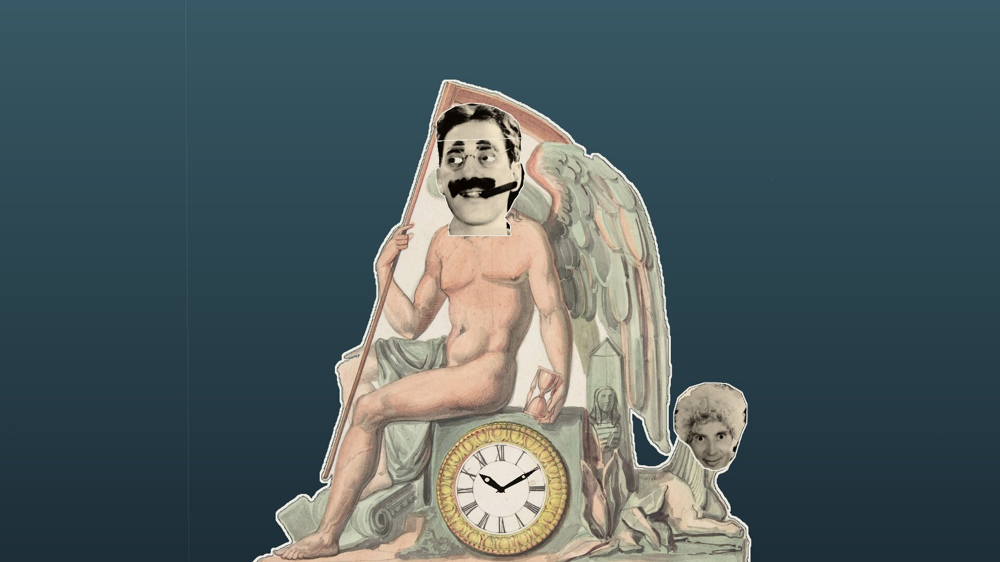
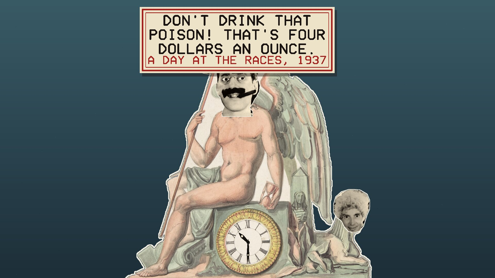
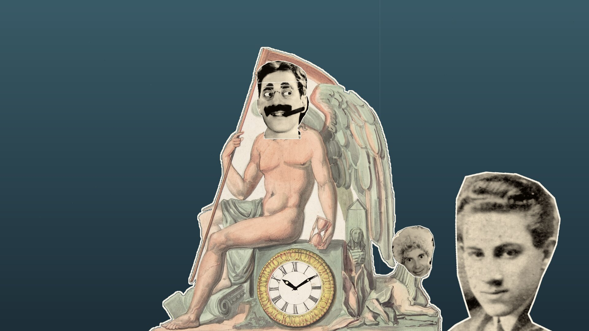

# Groucho Time

A screensaver clock cut out of old pictures, the way Terry Gilliam cut his for Monty
Python: Father Time sitting on his clock, from a nineteenth-century design, with
Groucho Marx's head pasted on. Runs on Linux, Windows and macOS. One of the
[Marx Brothers screensavers](https://github.com/mottipython/marx-screensavers).

## What it shows

- **The time**, on the engraving's own dial, with engraved hands.
- **The seconds**, in Groucho's eyes, which go to and fro behind holes cut in his
  head, like a cat clock's.
- **Every minute** his eyebrows go up and down.
- **Every quarter of an hour** the top of his head flips open on its hinge, and one of
  his own lines comes up out of it on a coiled spring: 51 of them, from *The
  Cocoanuts* to *A Day at the Races*, each with the film it is from.
- **Harpo is the sphinx**, silent, and now and then his head goes over to one side.
- **Now and then** Gummo, Chico or Zeppo peeks out from behind the clock.
- **About every minute and a half** something happens: his head spins round and comes up as Zeppo's; Margaret Dumont sweeps in and he waggles his eyebrows at her; Raquel Torres glides past and his head floats off after her in a cloud of paper hearts; the top of his head opens and Chico pops out on a spring; or Harpo's head goes up out of the sphinx on a spring.

Everything moves the way paper cut-outs do: in jerks, on twelve frames a second.

| | |
|---|---|
|  |  |
| On the quarter | Gummo |

## Where the pictures come from

All in the public domain.

- **Father Time's clock**: "Design for Clock", 19th century, from the
  [Metropolitan Museum of Art](https://www.metmuseum.org/art/collection/search/358177)
  (Open Access, CC0).
- **Groucho**: a 1931 portrait by Ralph F. Stitt for the Rivoli Theatre, from the
  Library of Congress ([Wikimedia Commons](https://commons.wikimedia.org/wiki/File:Groucho_Marx.jpg)).
- **Chico, Harpo and Zeppo**: the four Marx Brothers, 1931
  ([Wikimedia Commons](https://commons.wikimedia.org/wiki/File:Marx_Brothers_1931.jpg)).
- **Margaret Dumont**: *The Cocoanuts* (1929)
  ([Wikimedia Commons](https://commons.wikimedia.org/wiki/File:Margaret_Dumont_in_The_Cocoanuts_(1929).jpg)).
- **Raquel Torres**: a 1930s studio portrait
  ([Wikimedia Commons](https://commons.wikimedia.org/wiki/File:Raquel_Torres_(1930s)_(49429156891).jpg)).
- **Gummo**: "Four Marx Brothers", *The Times-Democrat*, New Orleans, 11 May 1913
  ([Wikimedia Commons](https://commons.wikimedia.org/wiki/File:Four_Marx_Bros_Mr_Green_Reception_New_Orleans_Times-Democrat_11_May_1913.png)).

`tools/make_cutouts.py` cuts them out along traced outlines, with a white paper edge.

## Running it yourself

    groucho-time                  full screen on every display
    groucho-time --window         in a window; Esc or Q quits
    groucho-time --mute           without the sound
    groucho-time --clock 10:14:55 start at that time of day instead of the real time
    groucho-time --snapshot out.bmp --time 3 --size 1920x1080

## How it was made

The program was written with Anthropic's Claude, working from the author's direction.
The lines are Groucho's own, as Wikiquote gives them.

## Building

Needs a C compiler, make and SDL2 (2.0.18 or newer). Build from the top of the source
tree, because the pictures in `assets/art` are built into the program.

    make

Packages are written to `dist/`, using the container in `tools/Containerfile`:

    podman build -t anathem-build -f tools/Containerfile tools
    podman run --rm --security-opt label=disable -v "$PWD":/src -w /src anathem-build make dist

## Credits and licence

The code is MIT. An unofficial, non-commercial homage, not connected with the Marx
Brothers' estate or the studios. Images are decoded with
[stb_image](https://github.com/nothings/stb) (public domain).
